# Assignment Documentation: Deploying a MERN Application through Terraform and Ansible

---

## 1. Objective and Scope

The objective of this assignment is to deploy the TravelMemory MERN application on AWS using Terraform for infrastructure provisioning and Ansible for configuration management and application deployment.

The implementation follows the assignment requirements for a VPC with public and private subnets, an Internet Gateway, a NAT Gateway, route tables, two EC2 instances, security groups, IAM roles, and an Ansible-driven deployment.

**Application repository:** https://github.com/UnpredictablePrashant/TravelMemory

### Scope

- Provision AWS networking and compute resources using Terraform.
- Place the web/application server in a public subnet and MongoDB server in a private subnet.
- Restrict SSH access using a key pair and source-based security-group rules.
- Install and configure MongoDB, Node.js/NPM, Nginx, and application dependencies using Ansible.
- Configure environment variables and start the Node.js application.
- Validate web access, service status, and database-backed behaviour.
- Capture evidence and publish source files to GitHub.

---

## 2. Solution Architecture

The deployment uses an AWS VPC in the `ap-south-1` (Mumbai) region. The public subnet hosts the web/application EC2 instance. The private subnet hosts the MongoDB EC2 instance. The Internet Gateway provides internet routing for the public subnet, while the NAT Gateway provides outbound internet access for private-subnet resources. The backend communicates with MongoDB over the private network.

### Architecture overview

```text
                         User's browser
                               |
                           HTTP :80
                               |
                        Internet Gateway
                               |
                 +---------------------------+
                 |       AWS VPC              |
                 |                             |
                 |  Public subnet              |
                 |  +----------------------+   |
                 |  | Web/Application EC2  |   |
                 |  | Nginx + React        |   |
                 |  | Node.js/Express      |   |
                 |  +----------------------+   |
                 |             |               |
                 |       MongoDB :27017        |
                 |             |               |
                 |  Private subnet             |
                 |  +----------------------+   |
                 |  | Database EC2         |   |
                 |  | MongoDB              |   |
                 |  +----------------------+   |
                 |                             |
                 | NAT Gateway for outbound    |
                 | internet from private tier  |
                 +-----------------------------+

Terraform: provisions AWS infrastructure
Ansible: configures hosts and deploys software over SSH
```

### Components

| Component | Placement | Purpose |
|---|---|---|
| VPC | AWS `ap-south-1` | Isolated network boundary |
| Public subnet | VPC public tier | Hosts web/application EC2 |
| Private subnet | VPC private tier | Hosts MongoDB EC2 |
| Internet Gateway | Attached to VPC | Internet route for public subnet |
| NAT Gateway + Elastic IP | Public subnet | Outbound internet access for private subnet |
| Terraform | Control machine | Creates and tracks infrastructure |
| Ansible | Control machine via SSH | Configures servers and deploys software |

---

## 3. Tools and Prerequisites

The following tools are expected to be used from an Ubuntu/WSL control machine. Record the actual versions used.

| Tool | Version / configuration |
|---|---|
| AWS CLI | [Paste `aws --version` output] |
| Terraform | [Paste `terraform -version` output] |
| Ansible | [Paste `ansible --version` output] |
| Python | [Paste `python3 --version` output] |
| AWS Region | `ap-south-1` |
| SSH key pair | [Key name; private key stored securely] |

AWS authentication was checked using:

```bash
aws sts get-caller-identity --profile [profile-name]
```

Do not include access keys, session tokens, private keys, or passwords in this report.

---

## 4. Terraform Infrastructure Implementation

Terraform defines the infrastructure as code. Provider and region settings are separated from variables so environment-specific values can be changed without hard-coding them throughout the configuration.

### Terraform source files

| Source file | Purpose |
|---|---|
| `terraform/versions.tf` | Declares Terraform and provider version constraints. |
| `terraform/provider.tf` | Configures the AWS provider, profile, and region. |
| `terraform/variables.tf` | Defines reusable input variables. |
| `terraform/terraform.tfvars` | Local environment values; exclude from source control. |
| `terraform/network.tf` | Defines the VPC, subnets, gateways, routes, and key-pair resource as implemented. |
| `terraform/security.tf` | Defines web and database security groups. |
| `terraform/compute.tf` | Defines EC2 instances, IAM role, and instance profile. |
| `terraform/outputs.tf` | Outputs the web public IP and database private IP. |

### 4.1 Terraform deployment commands

Run these commands from the Terraform directory:

```bash
terraform init
terraform fmt -recursive
terraform validate
terraform plan -out=mern-lab.tfplan
terraform apply mern-lab.tfplan
terraform output
```

Review the plan before applying. Confirm that the web instance is in the public subnet and the database instance is in the private subnet without a public IP.

### Deployment details

- **VPC ID:** [vpc-xxxxxxxx]
- **Web EC2 public IP:** [x.x.x.x]
- **Database EC2 private IP:** [10.x.x.x]
- **Terraform result:** [Success / Issues]

Do not publish sensitive Terraform state files.

### Terraform validation and plan

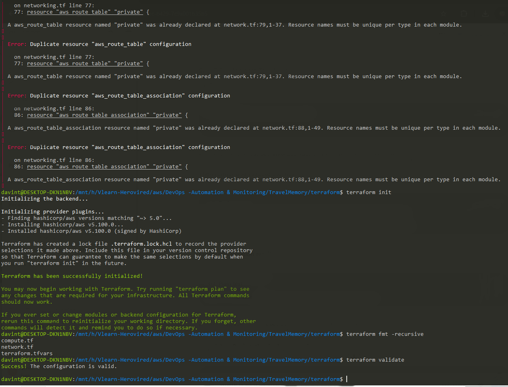


### Terraform apply and outputs

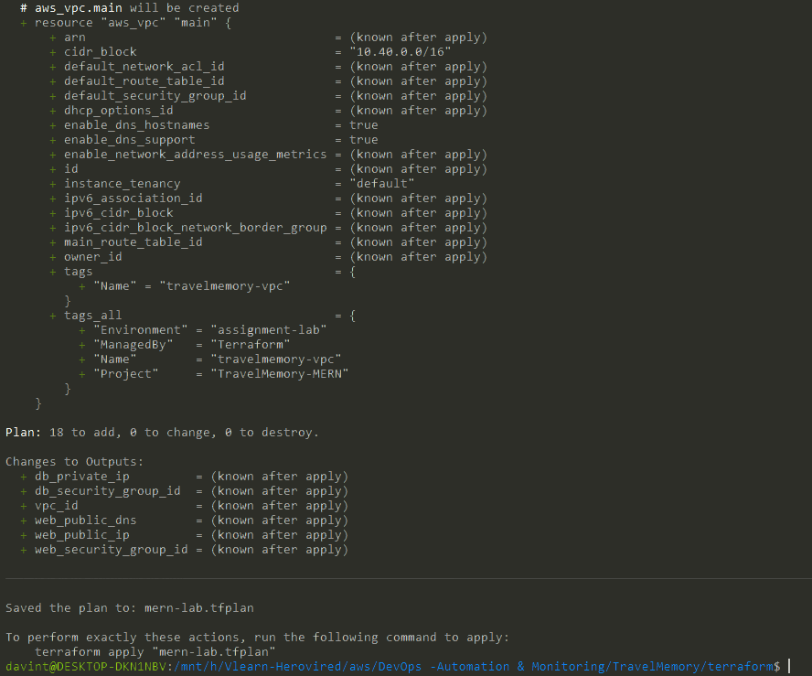
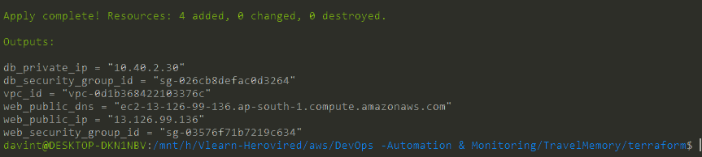
---

## 5. Network and Security Configuration

The VPC contains one public and one private subnet. The public route table routes internet-bound traffic through the Internet Gateway. The private route table routes outbound internet traffic through the NAT Gateway. The database instance should not have a public IP address.

### Intended security-group rules

| Rule | Allowed source | Purpose |
|---|---|---|
| Web SSH TCP/22 | Administrator public IP `/32` | Administrative access |
| HTTP TCP/80 | Internet, if public website access is required | Website access |
| Database SSH TCP/22 | Web security group or approved management path | Private-host administration |
| MongoDB TCP/27017 | Web security group only | Backend-to-database connection |

The deployed security-group rules must match the actual Terraform configuration. Do not allow SSH or MongoDB from `0.0.0.0/0`. Use least-privilege IAM permissions.

### VPC and subnet configuration

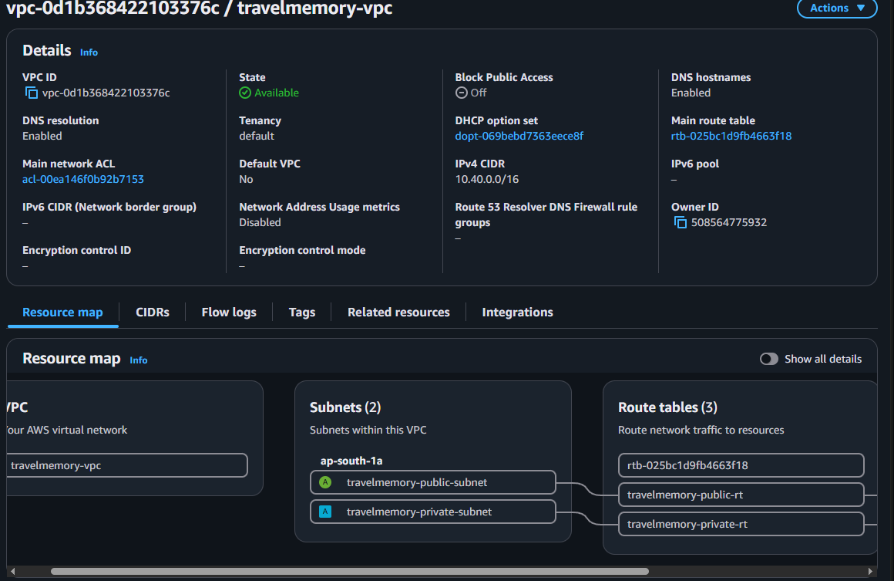


### Route tables and gateways

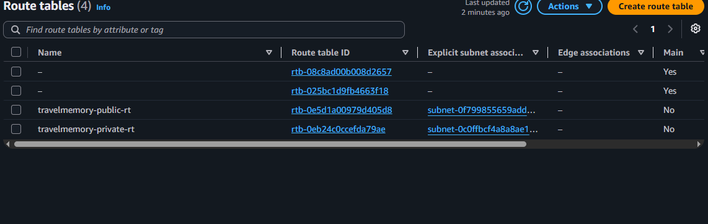


### Security groups and EC2 placement

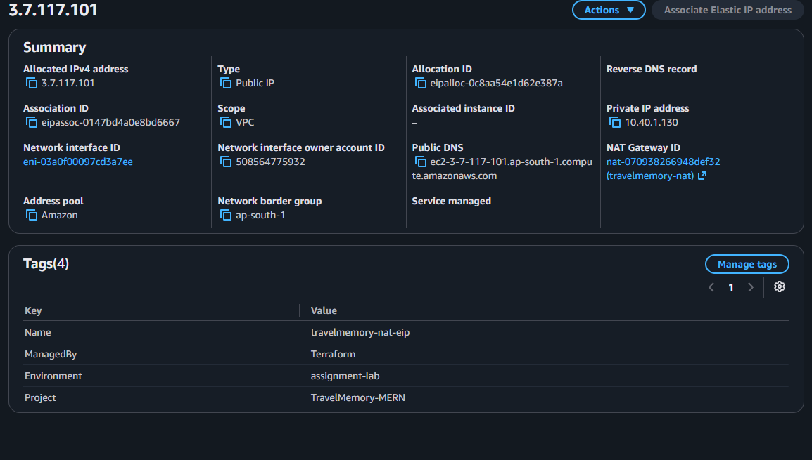
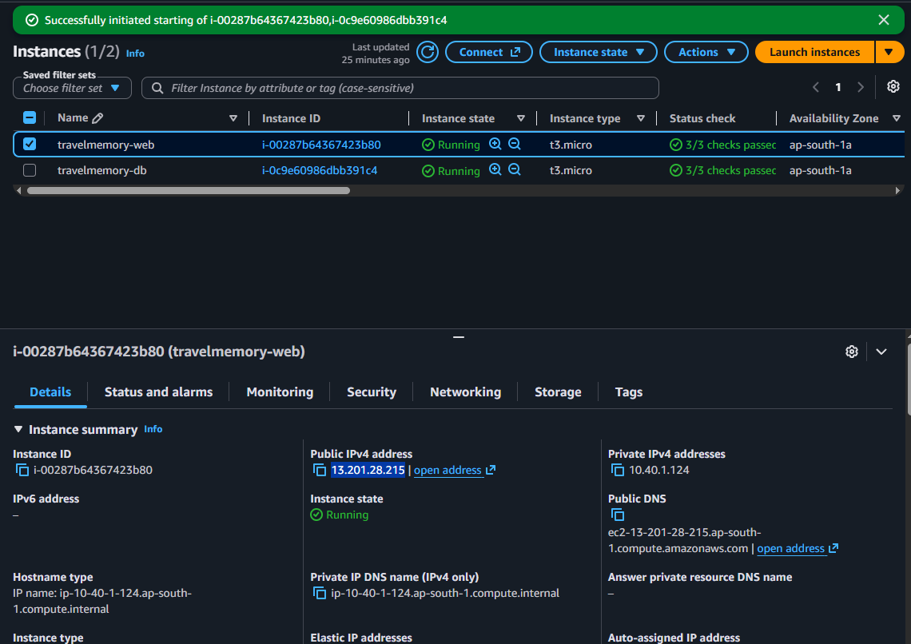

---

## 6. Ansible Configuration Management

Ansible connects from the control machine to the public web server and reaches the private database host through the configured SSH jump host. Inventory and variable files define environment-specific connection details and application/database settings.

### Ansible source files

| Source file | Purpose |
|---|---|
| `ansible/ansible.cfg` | Ansible defaults |
| `ansible/inventory.ini` | Host inventory; local-only configuration |
| `ansible/group_vars/all.yml` | Application/database variables and secrets; protect or encrypt this file |
| `ansible/site.yml` | Orchestrates database and web application roles |
| `ansible/roles/mongodb/tasks/main.yml` | Installs and configures MongoDB |
| `ansible/roles/mongodb/templates/mongod.conf.j2` | MongoDB bind and authentication configuration |
| `ansible/roles/webapp/tasks/main.yml` | Installs packages and deploys the application |
| `ansible/roles/webapp/templates/` | Environment, systemd, and Nginx templates |

### 6.1 Connectivity and deployment commands

Test connectivity:

```bash
ansible all -m ping
```

Run the playbook:

```bash
ansible-playbook site.yml
```

If variables are encrypted with Ansible Vault:

```bash
ansible-playbook site.yml --ask-vault-pass
```

Record the actual result:

- **Deployment result:** [Success / Issues]
- **Hosts reached:** [Web / Database]
- **Failed tasks:** [Actual count]

### Ansible connectivity test

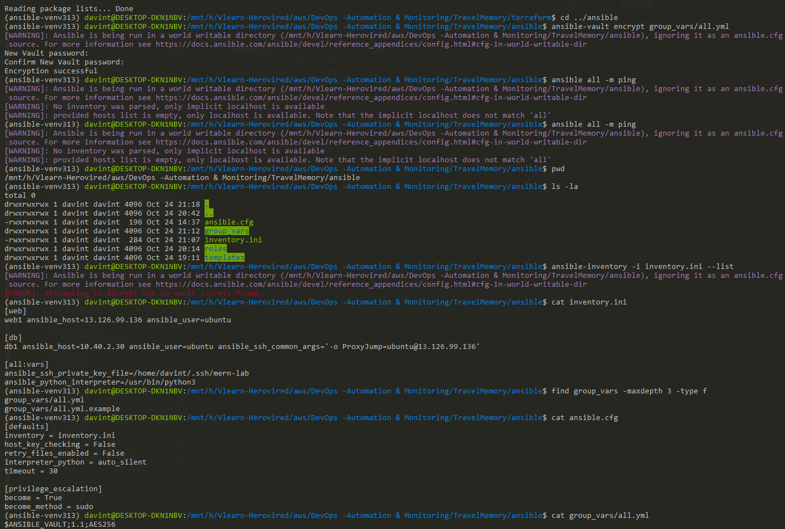

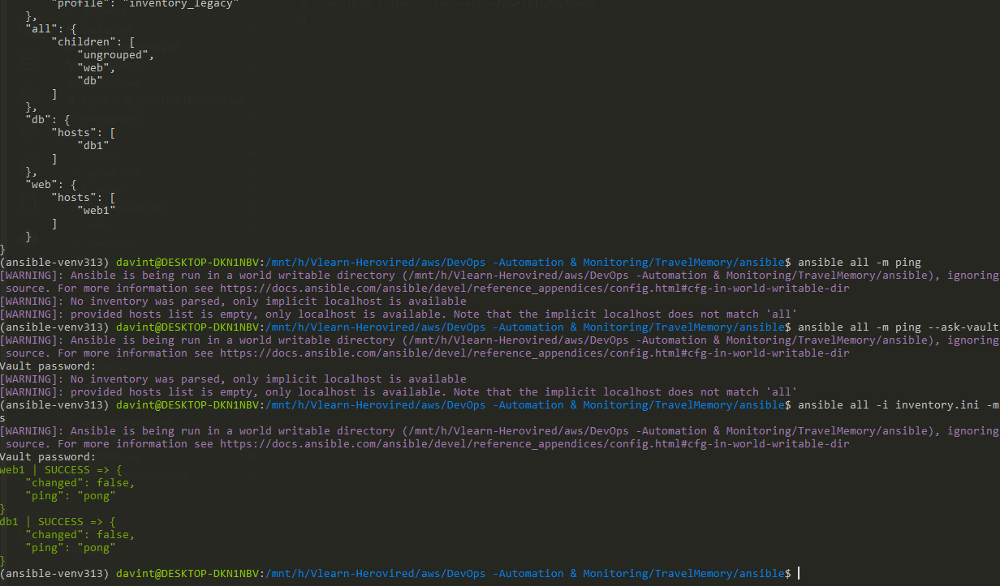

### Ansible deployment recap

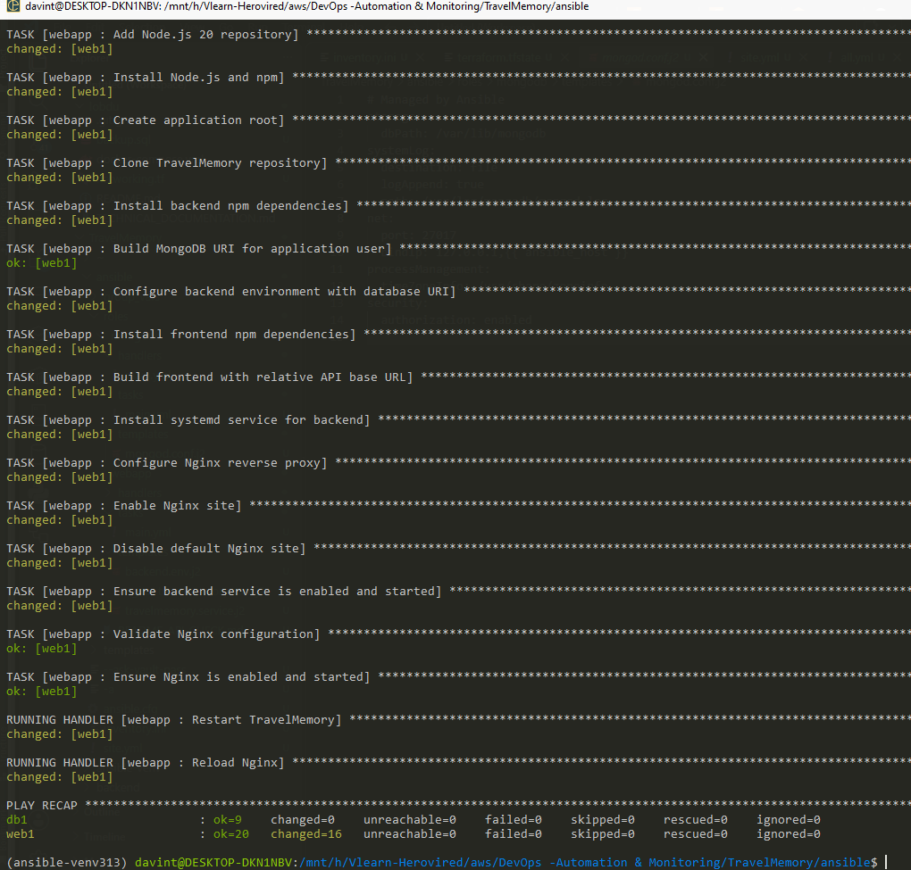

---

## 7. MERN Application Deployment

The TravelMemory repository is cloned to the web EC2 instance. The deployment installs Node.js/NPM, installs frontend and backend dependencies, configures the backend MongoDB URI, builds the React frontend, starts the backend with systemd, and configures Nginx to serve the frontend and proxy API requests.

Application repository: https://github.com/UnpredictablePrashant/TravelMemory

### 7.1 Application configuration checks

- The backend listens on the configured port (for example, `3001`).
- The MongoDB URI uses the database host's private IP and application-specific credentials.
- The frontend API URL must be browser-reachable. `localhost` in browser code refers to the visitor's computer.
- Nginx routing must match the actual frontend API calls and backend routes in the upstream repository.
- Never commit `.env` files, passwords, or generated credentials.

### 7.2 Verification commands

Replace `WEB_PUBLIC_IP` with the actual Terraform output.

```bash
curl -I http://WEB_PUBLIC_IP/
curl -i http://WEB_PUBLIC_IP/health

ansible web -b -m shell -a \
  "systemctl status travelmemory --no-pager"

ansible db -b -m shell -a \
  "systemctl status mongod --no-pager"

ansible web -b -m shell -a \
  "journalctl -u travelmemory -n 100 --no-pager"
```

Only describe `/health` as an application health check if the deployed configuration actually provides that endpoint.

### Application service status

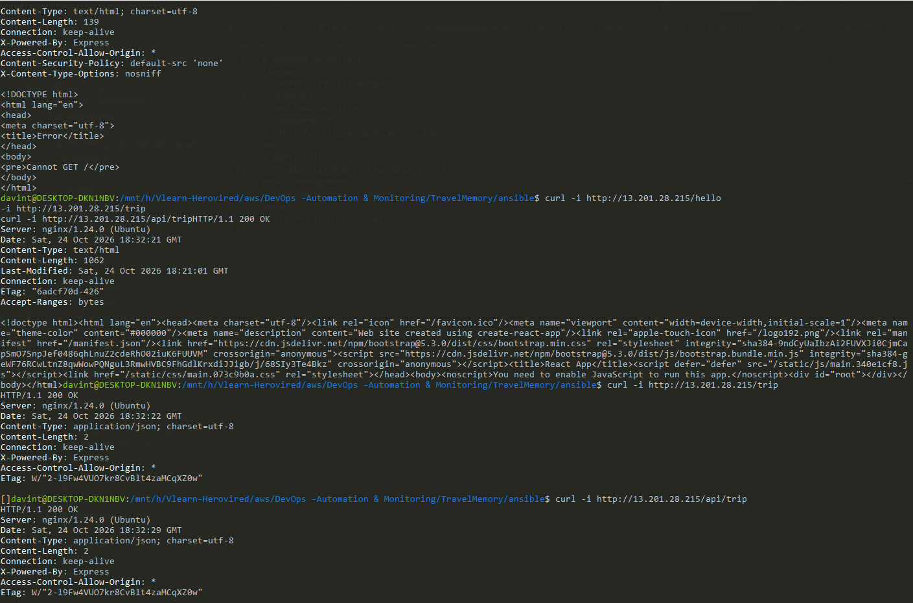

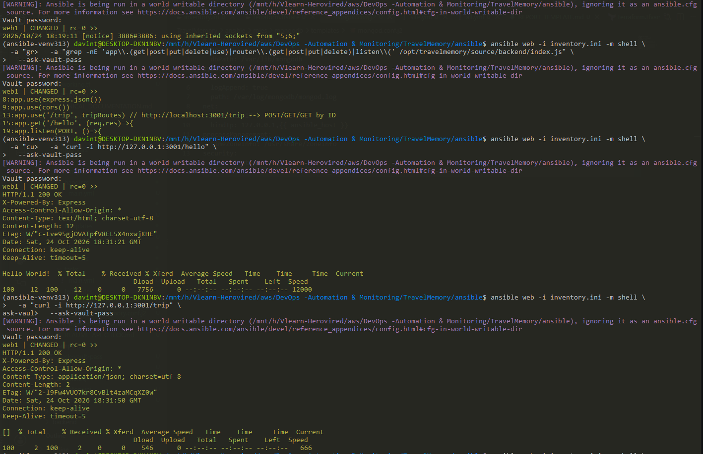

### TravelMemory running in browser

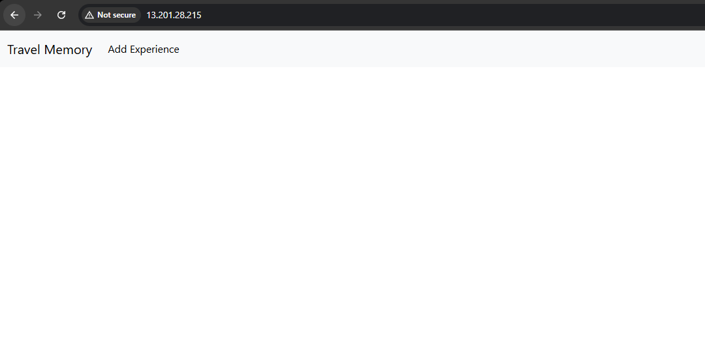

### Database-backed create/read test

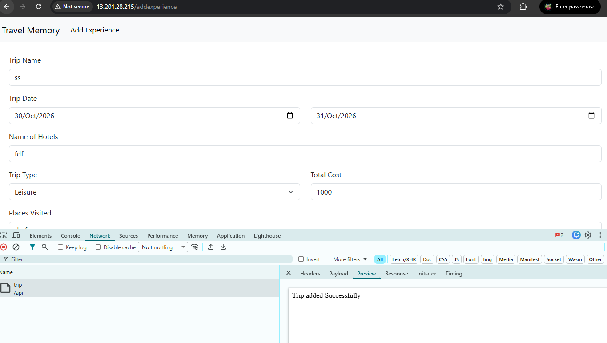

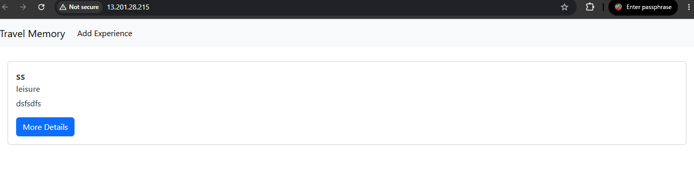

---

## 8. Validation and Testing

Complete this table only after running each test. Use **Pass**, **Fail**, or **Not tested** and include the observed evidence.

| Test | Result | Evidence / observation |
|---|---|---|
| Terraform validation | [Pass/Fail/Not tested] | [Output/screenshot] |
| Terraform resources provisioned | [Pass/Fail/Not tested] | [Resource IDs/console] |
| Ansible reaches both hosts | [Pass/Fail/Not tested] | [Ping result] |
| MongoDB service active | [Pass/Fail/Not tested] | [Service status] |
| Backend service active | [Pass/Fail/Not tested] | [Service status/logs] |
| Frontend loads via HTTP | [Pass/Fail/Not tested] | [Browser/curl result] |
| Frontend API requests succeed | [Pass/Fail/Not tested] | [Browser network/API evidence] |
| Data persists in MongoDB | [Pass/Fail/Not tested] | [Create/read after refresh] |
| Database is not publicly exposed | [Pass/Fail/Not tested] | [Private IP/security-group evidence] |

---

## 9. Security Hardening

- Restrict SSH access to the public host to the administrator's current public IP (`/32`).
- Do not assign a public IP to the database instance.
- Allow MongoDB only from the web security group or an approved private source.
- Enable MongoDB authentication and use separate administrative and application users.
- Never commit SSH private keys or credentials.
- Protect Terraform state and local variable files.
- Use Ansible Vault or an approved secrets manager for passwords.
- Keep operating system and application packages updated.
- Use least-privilege IAM permissions and avoid broad administrative policies.

---

## 10. Cost Management and Cleanup

AWS charges may apply to EC2 instances, EBS volumes, public IPv4 addresses, NAT Gateway uptime and data processing, and data transfer. The NAT Gateway can be a significant fixed-cost component. Check current AWS pricing and Cost Explorer; actual costs depend on region, uptime, and traffic.

After testing and saving evidence, destroy the lab resources:

```bash
cd terraform
terraform destroy
```

Review the plan and confirm deletion. Verify that the EC2 instances, NAT Gateway, Elastic IP, and resources created for this lab are removed. Keep local Terraform state until the destroy operation completes.

### Cleanup evidence

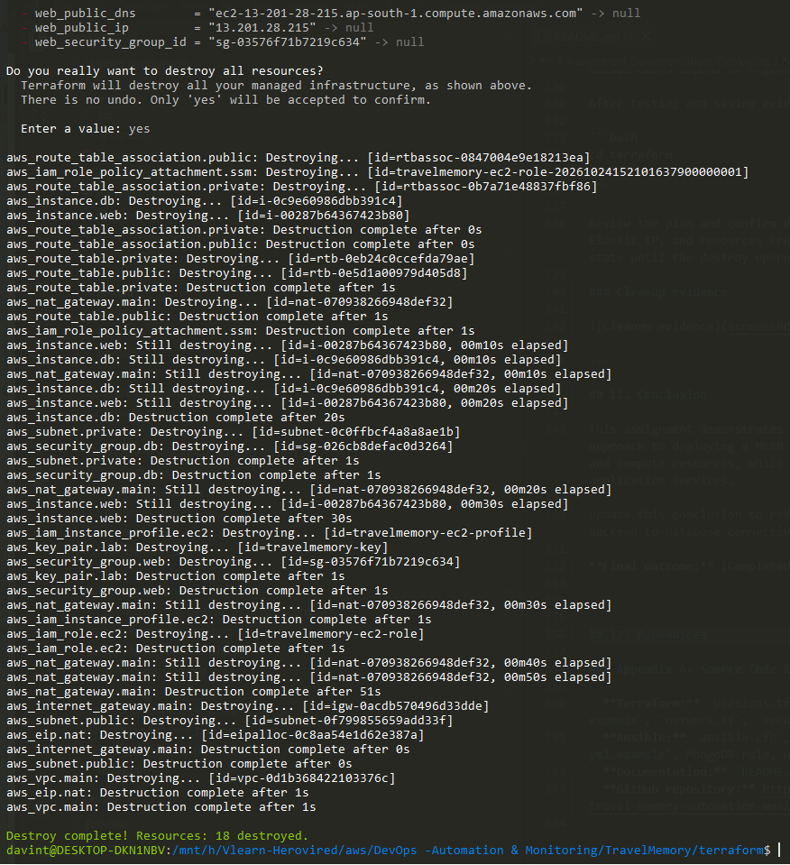

---

## 11. Conclusion

This assignment demonstrates an infrastructure-as-code and configuration-management approach to deploying a MERN application on AWS. Terraform provisions the network and compute resources, while Ansible configures the database, web server, and application services.

Update this conclusion to reflect actual test results for frontend availability, backend-to-database connectivity, security checks, and cleanup.

**Final outcome:** [Completed]

---

## 12. Appendices

### Appendix A. Source Code Inventory

- **Terraform:** `versions.tf`, `provider.tf`, `variables.tf`, `terraform.tfvars.example`, `network.tf`, `security.tf`, `compute.tf`, `outputs.tf`.
- **Ansible:** `ansible.cfg`, `inventory.ini.example`, `site.yml`, `group_vars/all.yml.example`, MongoDB role, web application role, and templates.
- **Documentation:** `README.md` and this assignment report.
- **GitHub repository:** https://github.com/vinjithkannan/travel-memory-automation-monitoring.git.
